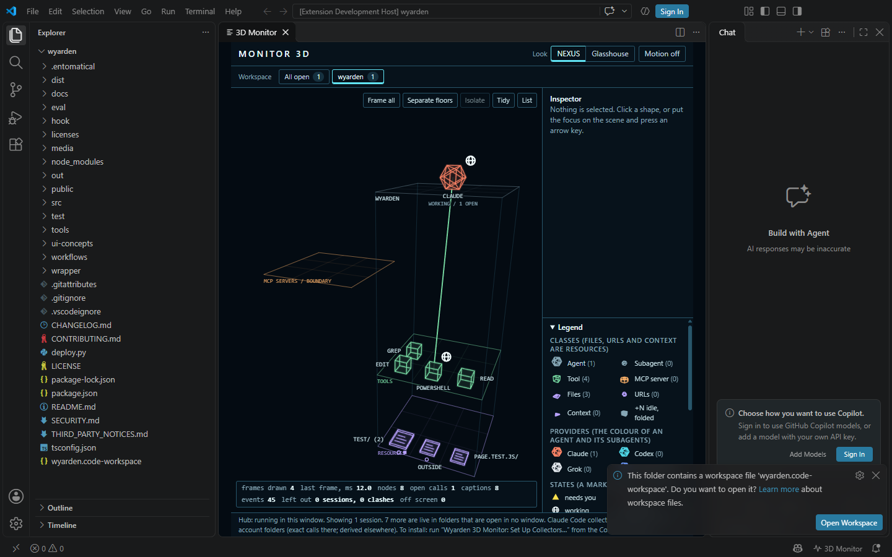

# Wyarden 3D Monitor

Wyarden shows what your Claude Code sessions are doing across your open VS Code windows. The 3D view connects agents and subagents to their tools, files, URLs, and MCP servers. Pick a window to focus on one project, or choose **All open** to see them together.

**0.1.2 preview** runs as a standalone editor extension. The current live feed supports Claude Code. [Download the VSIX](https://github.com/r-spring/wyarden/releases/tag/v0.1.2) · [User guide](https://github.com/r-spring/wyarden/blob/main/docs/wyarden-guide.md)



## Install and see your first session

1. Use VS Code 1.85 or a compatible newer 1.x editor on Windows or Linux. VS Code and VSCodium are the verified editor hosts on Windows.
2. Download **wyarden-monitor-3d-0.1.2.vsix**. In the editor, open the Command Palette, run **Extensions: Install from VSIX…**, and select the downloaded file. Reload the window if prompted.
3. Open a local folder. Start a signed-in Claude Code session in that folder and give it a task that reads a file in the project.
4. Click **3D Monitor** in the status bar or run **Wyarden 3D Monitor: Open**. Choose the chip for that editor window. Tool calls read from Claude Code transcripts appear as **derived**.

The monitor can use existing Claude Code session files and transcripts as soon as you install it. Optional collectors add direct call events after you review and approve changes to Claude Code settings. Use collectors only on a machine where you're the only user. [Collector setup and privacy](https://github.com/r-spring/wyarden/blob/main/docs/wyarden-guide.md#optional-collectors)

## Learn and troubleshoot

- Follow the [user guide](https://github.com/r-spring/wyarden/blob/main/docs/wyarden-guide.md) for the controls, multi-window setup, updates, removal, and troubleshooting.
- See [what is in the current preview](https://github.com/r-spring/wyarden/blob/main/ui-concepts/monitor-3d-live/README.md) and the [design and verification notes](https://github.com/r-spring/wyarden/tree/main/docs/monitor-3d).
- Report a problem with the Wyarden version, editor version, OS, and steps to reproduce. Share only sanitized logs and screenshots. [Issues](https://github.com/r-spring/wyarden/issues) · [Private security reporting](https://github.com/r-spring/wyarden/security/advisories/new)

## Build or preview from source

Clone the repository. Use a current Node.js LTS from the repository root.

```sh
node ui-concepts/monitor-3d-live/tools/pack.js
node --test "ui-concepts/monitor-3d-live/test/*.test.js"
```

The packer writes one VSIX for all supported hosts under `ui-concepts/monitor-3d-live/dist/`. Install it using the same VSIX command above. The browser-dependent tests use Edge or Chrome when available.

To explore the simulated view with sample activity, run `node ui-concepts/monitor-3d/serve.js` and open `http://127.0.0.1:4330/`. The editor extension reads live sessions. [Simulated preview](https://github.com/r-spring/wyarden/tree/main/ui-concepts/monitor-3d)

## About

Wyarden is maintained by Robert Spring and licensed under the GNU General Public License v3. Entomatical, the separate VS Code task board, has its own source and release guides. [Maintainer](https://github.com/r-spring) · [Changelog](https://github.com/r-spring/wyarden/blob/main/CHANGELOG.md) · [License](https://github.com/r-spring/wyarden/blob/main/LICENSE) · [Entomatical](https://github.com/r-spring/entomatical-public)
